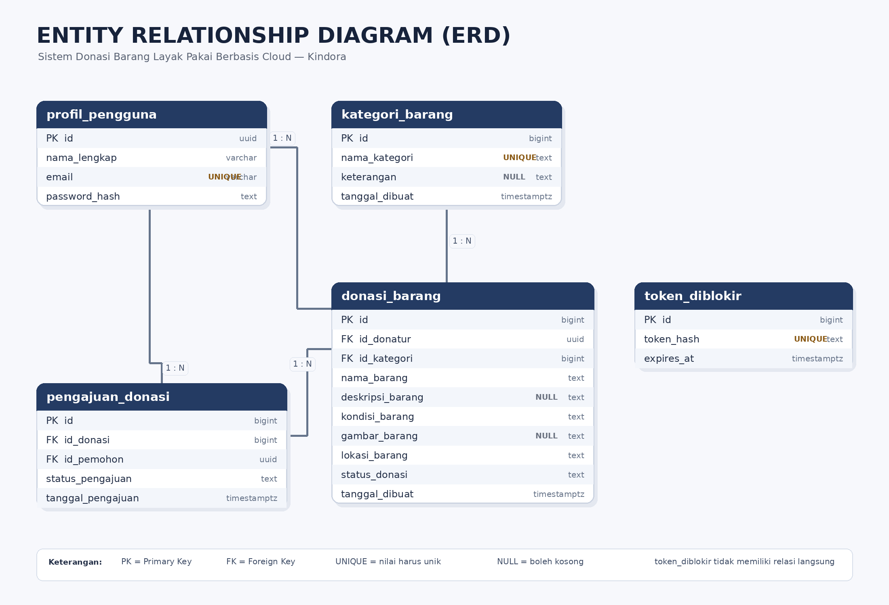

# Kindora - Backend

## Deskripsi Proyek

Kindora merupakan aplikasi digital untuk mempermudah penyaluran donasi barang layak pakai. Backend dikembangkan menggunakan Node.js dan Express.js, dengan Supabase PostgreSQL sebagai database.

## Teknologi

- **Node.js:** Menjalankan JavaScript pada server.
- **Express.js:** Mengelola request dan response API.
- **Supabase:** Menyediakan layanan database berbasis PostgreSQL.

## Menjalankan Aplikasi

Untuk memulai server dalam mode pengembangan menggunakan perintah berikut:

```bash
npm run dev
```

URL Server http://localhost:3000 

Alamat tersebut merupakan alamat server lokal, bukan alamat aplikasi yang dapat diakses secara publik.

## Pengelolaan Database

Rancangan tabel database diletakkan pada file:

`supabase/migrations/`

# Entity Relationship Diagram (ERD)

Berikut merupakan rancangan ERD database
Sistem Donasi Barang Layak Pakai Berbasis Cloud (Kindora).

