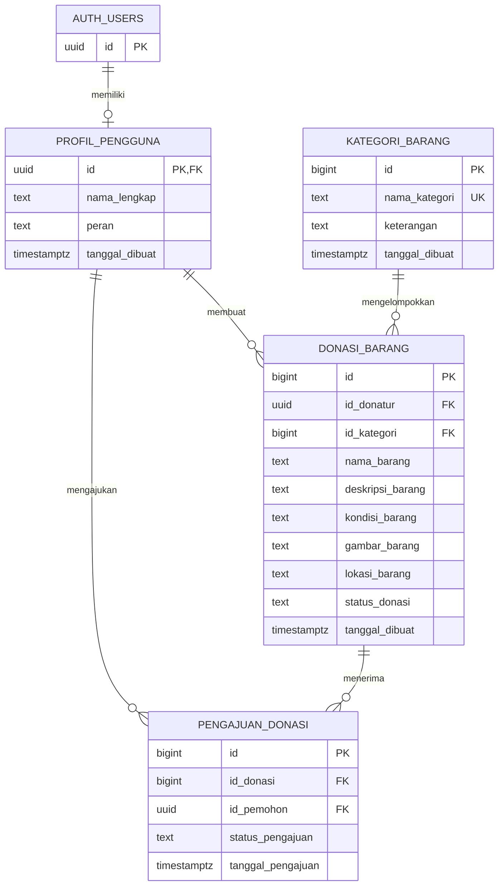

# Kindora - Backend

## Deskripsi Proyek

Kindora merupakan aplikasi digital untuk mempermudah penyaluran donasi barang layak pakai. Backend dikembangkan menggunakan Node.js dan Express.js, dengan Supabase PostgreSQL sebagai database.

## Teknologi

- **Node.js:** Menjalankan JavaScript pada server.
- **Express.js:** Mengelola request dan response API.
- **Supabase:** Menyediakan layanan database berbasis PostgreSQL.

## Struktur Direktori

```text
backend/
├── docs/
├── src/
│   ├── config/
│   │   └── supabase.js
│   ├── controllers/
│   ├── middleware/
│   ├── routes/
│   └── app.js
├── supabase/
│   └── migrations/
│       └── 01_kindora_tables.sql
├── .env
├── .env.example
├── .gitignore
├── package.json
├── package-lock.json
└── README.md
```

## Menjalankan Aplikasi

Untuk memulai server dalam mode pengembangan menggunakan perintah berikut:

```bash
npm run dev
```

URL Server http://localhost:3000 

Alamat tersebut merupakan alamat server lokal, bukan alamat aplikasi yang dapat diakses secara publik.

## Pengembangan API

Pembuatan REST API dilakukan secara bertahap mengikuti kebutuhan sistem Kindora. Endpoint nantinya akan disesuaikan dengan fitur yang dikembangkan, seperti pengelolaan barang donasi, kategori barang, data pengguna, dan pengajuan donasi.

## Pengelolaan Database

Rancangan tabel database diletakkan pada file:

`supabase/migrations/01_kindora_tables.sql`

## Rancangan ERD



### Keterangan Relasi

- **AUTH_USERS – PROFIL_PENGGUNA:** Profil pengguna terhubung dengan akun autentikasi Supabase.
- **PROFIL_PENGGUNA – DONASI_BARANG:** Satu donatur dapat membuat banyak data donasi.
- **KATEGORI_BARANG – DONASI_BARANG:** Satu kategori dapat digunakan oleh banyak barang donasi.
- **DONASI_BARANG – PENGAJUAN_DONASI:** Satu barang dapat memiliki beberapa pengajuan dari pemohon berbeda.
- **PROFIL_PENGGUNA – PENGAJUAN_DONASI:** Satu pengguna dapat mengajukan beberapa barang donasi.

**Keterangan atribut:** PK = Primary Key, FK = Foreign Key, UK = Unique Key.

## Tahap Pengembangan Saat Ini

Fondasi server, pengaturan konfigurasi, pembentukan struktur direktori, dan rancangan database telah disiapkan. Integrasi database, endpoint API, dan pengujian fitur akan dilanjutkan sesuai kebutuhan sistem.

---